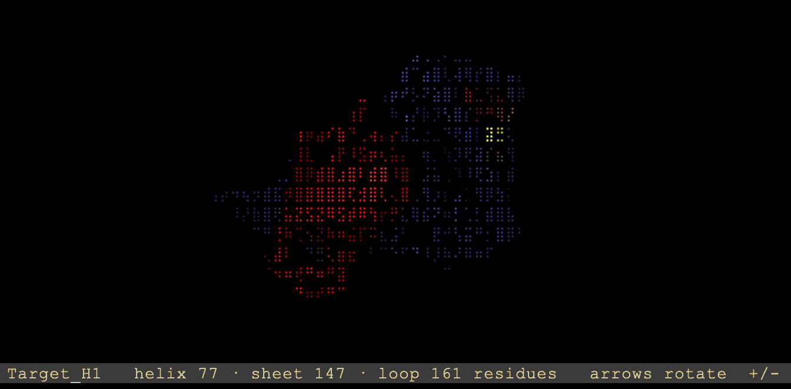

# pseview



View a PyMOL session (`.pse`) in your terminal: cartoon helices, sheets, and loops, in the session's own colours and saved camera angle. Needs Python 3 and numpy (`pip install numpy`).

Want your terminal to look like 1980s sci-fi? You're welcome!

If you have creative ideas to add, or want to make it display in HD, go ahead and make a pull request.

## Use

Set up your molecule in PyMOL, save it as a `.pse` session, then:

```
python pseview.py SESSION.pse                 # interactive viewer
python pseview.py SESSION.pse --png view.png  # save a 1200x800 picture
```

Or if you are feeling adventurous run it directly from the GitHub:

```
python <(curl -fsSL https://raw.githubusercontent.com/sarisabban/pseview/main/pseview.py) SESSION.pse
```

## Keys

| Key            | Action                              |
|----------------|-------------------------------------|
| ← → ↑ ↓        | rotate                              |
| `+` `-`        | zoom                                |
| `f`            | fit the molecule to the window      |
| `space`        | spin                                |
| `b`            | switch between braille and blocks   |
| `n`            | next object in the session          |
| `r`            | reset to the session's saved view   |
| `q`            | quit                                |
